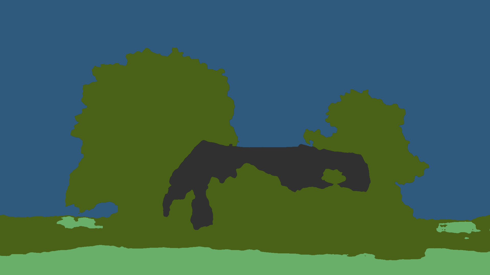
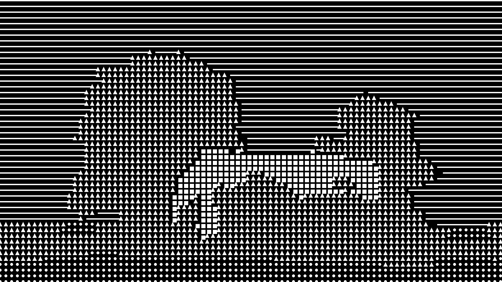
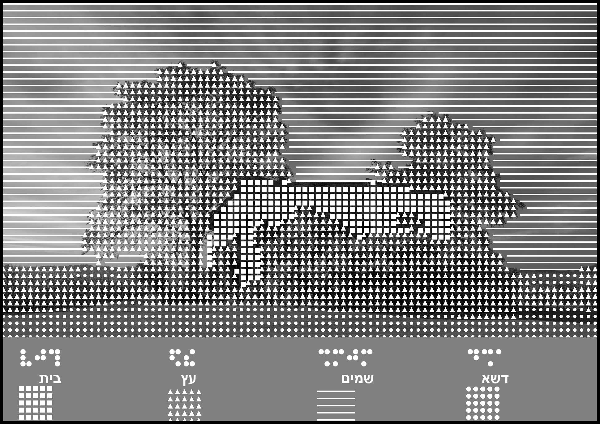

# TheUnseenView

A two-student software-engineering capstone prototype that turns images into textured relief models intended for 3D printing. Users crop an image, select patterns for detected regions, adjust the background, attach a legend and generate an STL file.

**Status:** research prototype. The public checkout preserves the implementation and example outputs, but is not currently a reproducible, production-ready application. See the restoration checklist below before attempting to run it.

## Example outputs

These are existing files from the project, not newly generated results.

| Segmentation | Tactile patterns |
| --- | --- |
|  |  |



The project includes Hebrew/English interfaces and Hebrew Braille-label assets. Their inclusion is not a claim of validated tactile readability or accessibility compliance.

## Architecture

```text
React image workflow
    -> Flask API (app.py)
    -> crop / resize / segmentation
    -> pattern + grayscale composition
    -> legend attachment
    -> NumPy / numpy-stl mesh generation
    -> STL download
```

- **Frontend:** React 18, React Bootstrap, Axios, React Router.
- **Backend:** Flask / Flask-CORS, Pillow, NumPy, OpenCV and numpy-stl.
- **Segmentation dependency:** a vendored Detectron2 tree and model configuration. Detectron2 is third-party work, not an implementation by this project's authors; retain its license and attribution.
- **Mesh generation:** `stlMaker.py` converts image intensity to relief height. Current constants specify a 200 mm width, 0.1 mm sample spacing and 1.6–3.2 mm relief heights.

## Public API flow

| Method / path | Purpose |
| --- | --- |
| `POST /cropImage` | Accept an image and crop data; resize and segment it |
| `GET /getDetectedObjects` | Return detected regions |
| `POST /chosenPatterns` | Assign patterns and build the legend |
| `GET /grayscaled?brightness=...` | Compose the patterned and grayscale image |
| `GET /legendAttached` | Attach the legend |
| `POST /generateLithophane` | Generate the STL |
| `GET /lithophaneStl` | Download the generated file |

## Local setup and restoration

The frontend uses Create React App:

```sh
npm ci
npm start
```

This starts the UI, not a working end-to-end pipeline. The components currently reference the historical HTTP API at `theunseenview.org:777`; use a configurable local API URL before sending images. Do not upload private images to that historical endpoint.

The backend entry point is `python app.py`, but **the following prerequisites must first be restored**:

1. Recover the original `DetectorSeg.py` source. `app.py` imports it, but only compiled cache files appear in this checkout. `Detector.py` has a different constructor and method signature and is not a drop-in replacement.
2. Reconstruct and pin a compatible Python / PyTorch / Detectron2 environment. There is no project-level requirements file or verified environment lock. Legacy Pillow APIs are also used.
3. Provision model weights and verify the label/font assets and their redistribution permissions. The repository includes Arial and Hebrew Braille font files.
4. Create writable processing directories and replace Windows-specific paths for portability.
5. Configure the frontend's backend URL and restrict CORS before any hosted use.

The backend's current entry point binds to all interfaces on port 777. Use an isolated development environment until the issues below are addressed.

## Limitations and next steps

- Shared output filenames make the current pipeline unsuitable for concurrent users; add per-job directories and explicit job states.
- Upload size/type validation, authentication, worker isolation, timeouts and resource limits need implementation before public deployment.
- STL generation is CPU/memory intensive. Add mesh/manifold checks and a small regression fixture before claiming print readiness.
- The Braille legend and tactile patterns require review with intended users and appropriate accessibility expertise.
- No end-to-end test suite for the application or reproducible deployment is included. Tests under `detectron2/` belong to that dependency.

The most useful next milestone is a reproducible local image-to-STL example, followed by an asynchronous job API with isolated processing and measurable tests.

## Attribution

Developed as a two-person student project. Repository history includes contributions under Elad and Ido-Cohen; commit counts do not establish individual responsibility for every feature. Third-party Detectron2 code retains its own license. No production adoption or measured user outcome is claimed here.
